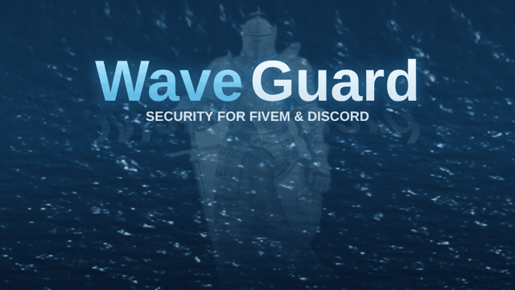
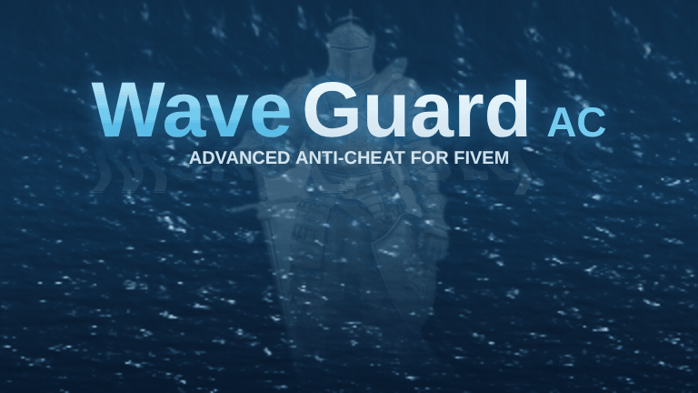
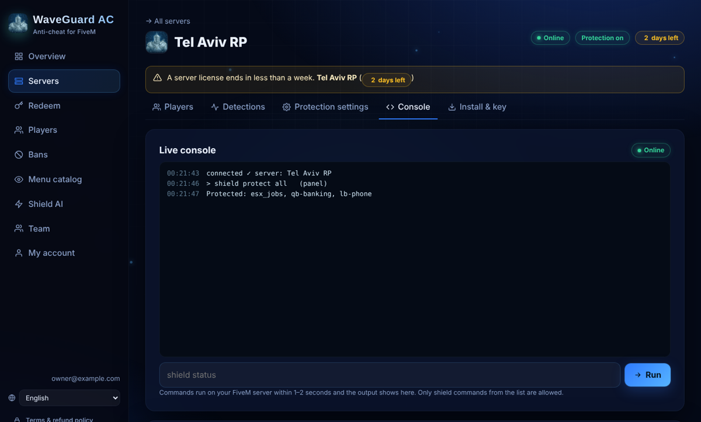
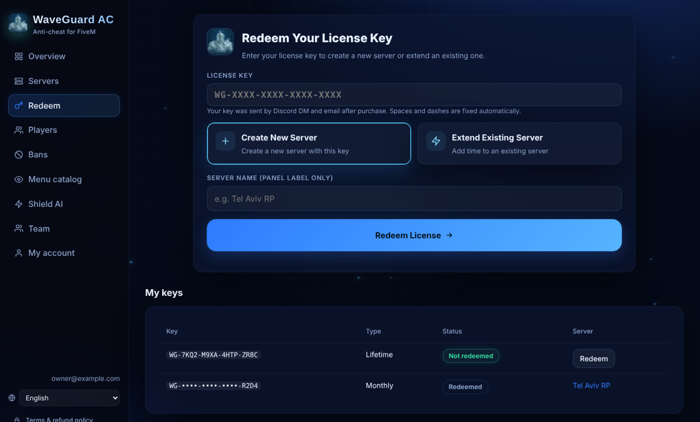
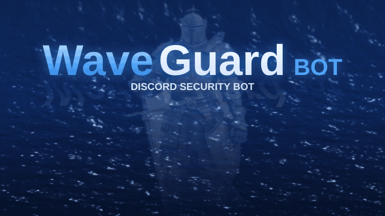
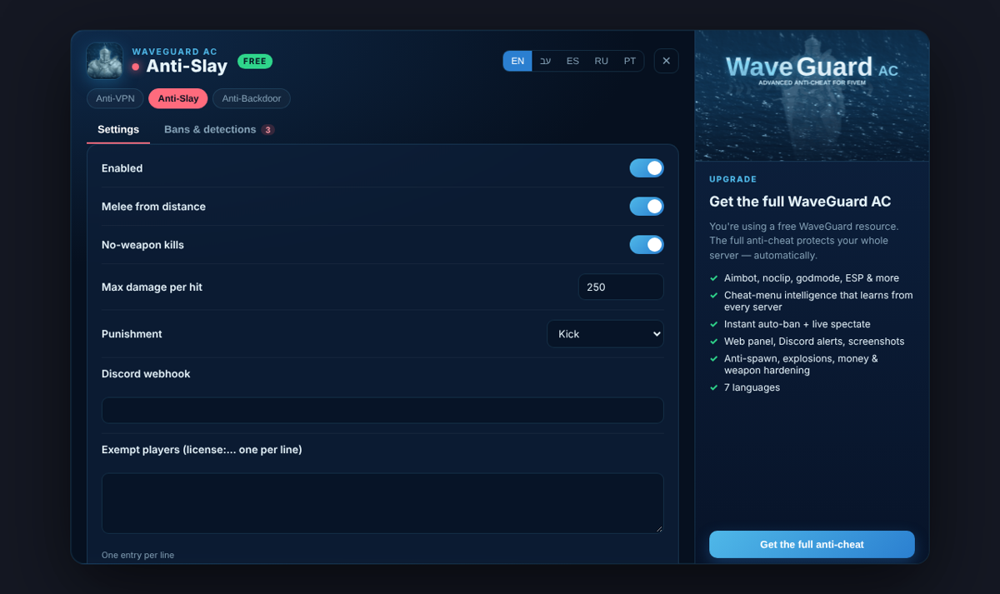

<div align="center">



# WaveGuard

**FiveM anti-cheat, Discord security bot and free security tools — one family, one panel.**

[](https://waveguard-ac.vercel.app)
[](https://waveguard-acsecurity-bot-site.vercel.app)
[](https://waveguard-ac.vercel.app/hub/)
[](https://discord.gg/YjHkkwr5dD)

[English](#english) · [עברית](#עברית)

</div>

---

## English

WaveGuard is a security product family by **Aharon the gamer** (Israel):

| Product | What it is | Link |
|---|---|---|
| **WaveGuard AC** | Server-side FiveM anti-cheat with a live web panel | [waveguard-ac.vercel.app](https://waveguard-ac.vercel.app) |
| **WaveGuard Security Bot** | Discord security bot: anti-nuke, anti-raid, join gate, quarantine, automod, verification | [bot website](https://waveguard-acsecurity-bot-site.vercel.app) |
| **Free FiveM resources** | Anti-VPN, Anti-Slay, Anti Magic-Bullet, Anti-Backdoor — each with its own F5 panel | [Discord](https://discord.gg/YjHkkwr5dD) |
| **Free security tools** | File / link / FiveM-resource scanners and more, right in the browser | [waveguard-ac.vercel.app/hub](https://waveguard-ac.vercel.app/hub/) |

### WaveGuard AC — FiveM anti-cheat



- **Server-side detection** — godmode, noclip, aimbot / silent aim, teleport, spawns, explosions, money and weapon exploits, cheat-menu signatures and more (80+ categories).
- **Log Analyzer** — every server event a player fires is logged. The anti-cheat learns what is normal on *your* server and flags abnormal event spam, impossible amounts (e.g. `5,000,000` when everyone else sends `500`) and money that jumps right after a rare event — naming the exploited event.
- **No false bans by design** — suspicion score per player, auto-decisions only when several independent signals agree, a test mode (dry run), and an AI second opinion.
- **Real video evidence** — a continuous clip from the cheater's screen (10–20 s before the detection + the ban), playable in the panel and in Discord.
- **Live web panel** — players, live view, kick / ban, detections, settings, bans with evidence, team roles, 7 languages.
- **Live console** — run anti-cheat commands (`include all`, `protect all`, `update`, `test <id> <category>` …) from the website and watch the log in real time.
- **Licenses** — redeem a key to create a new server or extend an existing one; renewal reminders by Discord DM, email and panel banner.
- **ESX / QBCore / QBox** support, one-command updates (`shield update`).

<p>


</p>

**Install (4 lines in `server.cfg`)** — everything else is managed on the website:

```cfg
set shield_server_id "srv_..."
set shield_key "sgk_..."
exec @waveguardac/perms.cfg
ensure waveguardac
```

### WaveGuard Security Bot



Anti-nuke, anti-raid, join gate, quarantine, automod, verification, welcome cards, moderation and a web dashboard. [Add it from the website](https://waveguard-acsecurity-bot-site.vercel.app).

### Free FiveM resources

Four free resources, each with its own in-game **F5 panel** (settings + ban list):

- **Anti-VPN** — blocks VPN / proxy joins (proxycheck.io, works without a key).
- **Anti-Slay** — stops impossible kills: melee from distance, bullet hits with no weapon, silent aim (hits behind the shooter), damage spikes.
- **Anti Magic-Bullet** — catches one shot hitting several players at once, and hits behind the shooter's back.
- **Anti-Backdoor** — scans your resources for backdoor patterns and catches known backdoor events (honeypot).



### FAQ

**Is it free?** The four resources, the free tools and the security bot are free. WaveGuard AC is paid (monthly or lifetime) — see the [website](https://waveguard-ac.vercel.app).

**Will it ban innocent players?** Every auto-ban needs strong evidence; you can run in test mode first, every ban keeps its evidence (video, path, events), and bans can be reviewed and revoked in the panel.

**Where do I get help?** [Discord](https://discord.gg/YjHkkwr5dD).

---

## עברית

WaveGuard היא משפחת מוצרי אבטחה של **Aharon the gamer** (ישראל):

- **WaveGuard AC** — אנטי-צ'יט לשרתי FiveM בצד השרת, עם פאנל ניהול חי, זיהוי לפי לוגים, וידאו של הצ'יטר, קונסולה חיה ומערכת רישיונות. [לאתר](https://waveguard-ac.vercel.app)
- **WaveGuard Security Bot** — בוט אבטחה לדיסקורד: אנטי-ניוק, אנטי-ריידים, שער כניסה, הסגר, אוטומוד ואימות. [לאתר הבוט](https://waveguard-acsecurity-bot-site.vercel.app)
- **4 משאבים חינמיים ל-FiveM** — אנטי-VPN, אנטי-סליי, אנטי מג'יק-בולט ואנטי-באקדור, לכל אחד פאנל F5 משלו.
- **כלי אבטחה חינמיים** — סורקי קבצים, קישורים ומשאבי FiveM, ישר בדפדפן. [לכלים](https://waveguard-ac.vercel.app/hub/)

> **חשוב:** הכלים החינמיים הם לא אנטי-וירוס. אם לא נמצאו ממצאים, זה לא אומר שקובץ בטוח.

## Links

- Website: <https://waveguard-ac.vercel.app>
- Security Bot: <https://waveguard-acsecurity-bot-site.vercel.app>
- Discord: <https://discord.gg/YjHkkwr5dD>
